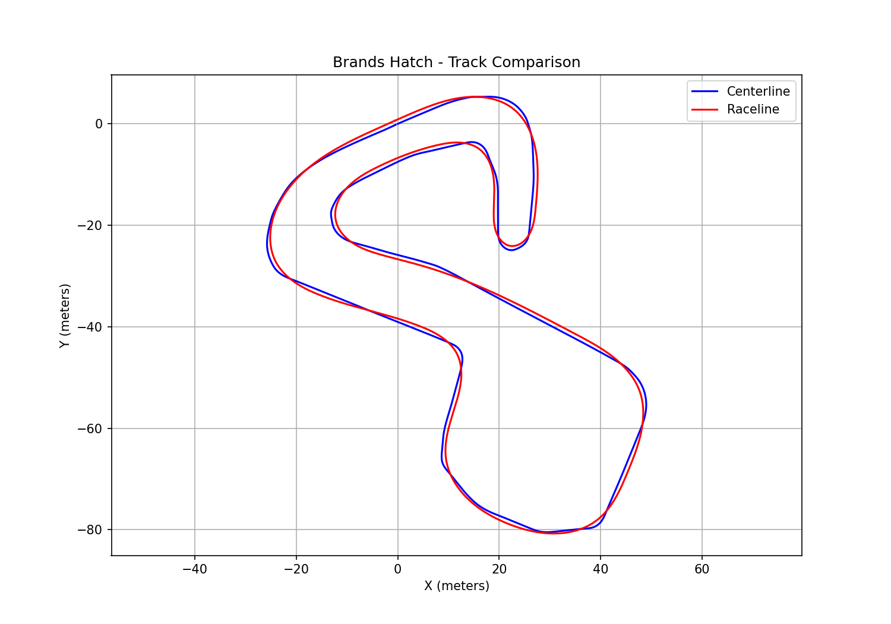
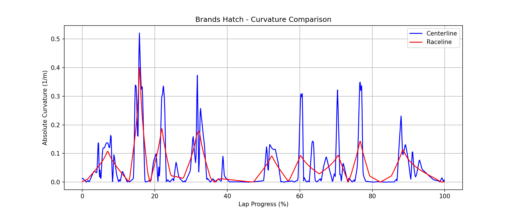

# Racing Line Analyzer

A ROS 2 and Docker-based data processing pipeline for comparing the centerline and racing line of a Formula Student-style autonomous racing track.

## Project Overview

The goal of this project is to analyze and compare two driving paths on the Brands Hatch circuit:

- **Centerline:** A path approximately following the center of the track.
- **Raceline:** A precomputed racing trajectory designed to reduce path curvature.

The system calculates geometric properties of both paths and generates visualizations and numerical comparisons.

The project focuses on trajectory analysis rather than generating a new optimal racing line.

## Technologies

- Ubuntu 24.04
- ROS 2 Jazzy
- Python 3.12
- Docker and Docker Compose
- Matplotlib
- CSV and JSON

## Dataset

Source: [F1TENTH Racetracks](https://github.com/f1tenth/f1tenth_racetracks)

Track: Brands Hatch

Two CSV files are used:

### Centerline

File: `BrandsHatch_centerline.csv`

Contains 781 points with:
- X and Y coordinates (meters)
- Track width to the right (meters)
- Track width to the left (meters)

### Raceline

File: `BrandsHatch_raceline.csv`

Contains 1,756 rows of trajectory data, including a repeated closing point.

The columns include:
- Cumulative distance
- X and Y coordinates
- Heading angle
- Curvature
- Reference velocity
- Longitudinal acceleration

The dataset contains a precomputed racing line. This project independently estimates geometric curvature from the path coordinates for comparison.

## System Architecture

The system uses two Docker containers and four ROS 2 nodes.

### Container 1: Data Source

**Track Publisher**
- Reads both CSV files
- Extracts trajectory coordinates
- Publishes data every five seconds

Topic: `/track_data`

### Container 2: Processing

**Geometry Analyzer**
- Subscribes to `/track_data`
- Calculates path lengths
- Estimates curvature using consecutive points
- Publishes results to `/geometry_results`

**Comparison Node**
- Subscribes to `/geometry_results`
- Calculates length differences
- Compares maximum and average absolute curvature
- Publishes results to `/comparison_results`

**Visualizer**
- Subscribes to `/comparison_results`
- Generates track and curvature comparison plots
- Exports summary statistics

Data flow:

```text
CSV files
   |
   v
Track Publisher
   |
   | /track_data
   v
Geometry Analyzer
   |
   | /geometry_results
   v
Comparison Node
   |
   | /comparison_results
   v
Visualizer
   |
   v
PNG plots + JSON summary
```

## Algorithms

### Path Length

The total path length is calculated by summing the Euclidean distances between consecutive points, including the closing segment when necessary.

### Curvature

Curvature is approximated using the change in heading angle between consecutive path segments divided by the average adjacent segment length.

The algorithm handles closed trajectories and normalizes heading differences to avoid discontinuities at the -pi/pi boundary.

### Comparison

The system compares:
- Total path length
- Maximum absolute curvature
- Mean absolute curvature across sampled points

Note that point-based curvature averages can be affected by differences in sampling density. The results should be interpreted as geometric estimates.

## Results

Results from the Brands Hatch dataset:

| Metric | Result |
|---|---|
| Centerline length | 356.29 m |
| Raceline length | 350.85 m |
| Length difference | 5.44 m |
| Maximum curvature reduction | 23.16% |

### Track Comparison

The following plot compares the centerline (blue) and
the precomputed racing line (red) of Brands Hatch.



### Curvature Comparison

The following plot shows the absolute curvature along
both trajectories, calculated using consecutive points.



The analyzed raceline is shorter and has a lower maximum estimated curvature.

These results do not directly establish a faster lap time. Vehicle dynamics, tire grip and speed constraints would be needed for that conclusion.

## Running with Docker

Requirements:
- Docker Engine
- Docker Compose
- Linux host with support for host networking and IPC

From the project root:

```bash
docker compose build
docker compose up
```

On systems requiring administrator privileges, prefix these commands with `sudo`.

The Compose configuration uses:

- `network_mode: host`
- `ipc: host`
- `ROS_DOMAIN_ID=42`

Host IPC is used for compatibility with ROS 2 communication in the tested Linux environment. This reduces container isolation and should be considered when deploying elsewhere.

The containers run the complete pipeline, without requiring ROS 2 to be installed directly on the host.

## Generated Outputs

After launching the containers, generated files are saved to the `results/` directory:

- `track_comparison.png`
- `curvature_comparison.png`
- `summary.json`

## Project Structure

```text
racing-line-analyzer/
├── Dockerfile
├── compose.yaml
├── README.md
├── .gitignore
├── BrandsHatch_centerline.csv
├── BrandsHatch_raceline.csv
└── racing_ws/
    └── src/
        └── racing_line_analyzer/
            ├── package.xml
            ├── setup.py
            └── racing_line_analyzer/
                ├── track_publisher.py
                ├── geometry_analyzer.py
                ├── comparison_node.py
                └── visualizer.py
```

## Limitations and Future Improvements

- Curvature estimates depend on point sampling and numerical approximation.
- The existing racing line is analyzed, not optimized by this project.
- Lap-time performance is not calculated.
- Future work could include distance-weighted metrics, path smoothing, speed planning and automated tests.

## Acknowledgments

Track data is sourced from the F1TENTH Racetracks repository. The dataset creators are credited for providing the reference trajectories.
